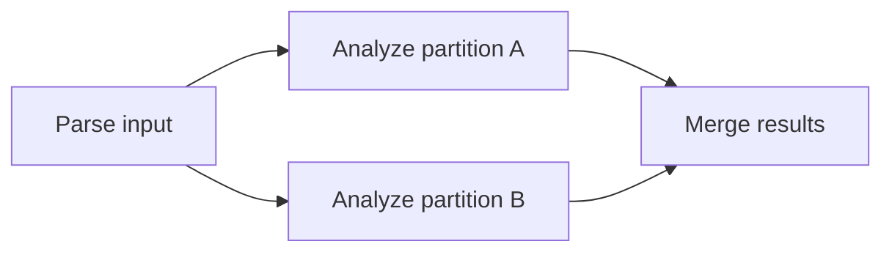

# TaskOrbit

**C++20 · Multicore CPUs · Design stage · Apache-2.0**

TaskOrbit is a task scheduler designed to run fine-grained tasks on a shared thread pool. Each request can submit independent tasks or a directed acyclic graph (DAG). Dependencies determine **when a task is ready**. A per-request concurrency limit determines **how many workers may run that request’s tasks at once**. Workers use lock-free queues and work stealing to share ready tasks.

> 🚧 The repository currently contains the project documentation, license, and Git ignore rules. The scheduler runtime is awaiting implementation.

## ⚙️ How scheduling works

Consider a pool of **64 workers**. Request A has a limit of **8 workers** and submits the following graph.

- **Task dependencies.** Once parsing finishes, the two partitions can run in parallel. The merge becomes ready only after both analyses finish.
- **Concurrency limits.** With two partitions ready, request A can use up to two workers. Even with thousands of ready tasks, A can use at most eight workers at once. Other workers can serve request B.
- **Work stealing.** A worker that holds a permit for A can take ready tasks from another of A’s queues when its preferred queue runs dry. A worker joining A must first acquire a permit, so stealing respects the same limit.
- **Batching.** A submitter can group short tasks into blocks. A worker can process consecutive blocks for the same request under one permit. Submitting tasks of unknown duration individually leaves the remaining tasks available for other workers to claim.

## 📋 Implementation status

✅ Complete · 📐 Designed · ⬜ Pending implementation · 🧪 Pending validation

| Component | Scope | Status |
|---|---|---|
| Repository setup | Project README, Apache-2.0 license, and ignore rules for OS, VS Code, and build artifacts | ✅ Complete |
| Shared thread pool | Workers select and claim ready tasks across requests | 📐 Designed · ⬜ Pending implementation |
| Per-request concurrency limits | Acquire a permit when joining a request, reuse it across blocks, and release it when leaving | 📐 Designed · ⬜ Pending implementation |
| Lock-free queues and work stealing | Each request has multiple queues. Workers try their preferred queue first, then steal from another | 📐 Designed · ⬜ Pending implementation |
| Bulk submission and ring buffers | Submit short tasks in blocks, reserve empty rings for growth, and reclaim retired rings once readers and writers have finished accessing them | 📐 Designed · ⬜ Pending implementation |
| DAG scheduling | Track unfinished predecessors and publish a successor when its last predecessor completes | ⬜ Pending implementation |
| Build, tests, and benchmarks | Set up the build, test dependency ordering, concurrency limits, and stealing correctness, and measure scheduling overhead for small tasks | ⬜ Pending implementation · 🧪 Pending validation |

## 🖥️ Language and target platforms

TaskOrbit requires **C++20** and a matching standard library. The table lists the initial build and test targets. Minimum OS and compiler versions will be documented after validation.

| Operating system | CPU architecture | Target hardware | Toolchain | Validation |
|---|---|---|---|---|
| Linux | x86-64 | Intel and AMD multicore workstations and servers | GCC, Clang | 🧪 Pending |
| macOS | arm64 | Apple silicon Macs | Apple Clang | 🧪 Pending |
| Windows | x64 | Intel and AMD 64-bit PCs and workstations | MSVC | 🧪 Pending |

## 📄 License

[Apache License 2.0](LICENSE)
